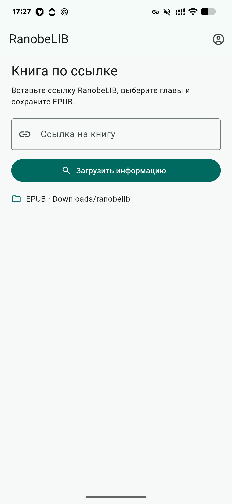

# RanobeLIB Downloader

Приложение для Android 10+ позволяет сохранять книги с RanobeLIB в формате EPUB.

**[Скачать APK для Android](https://github.com/ashkryab-fl/ranobelib_downloader/releases/latest/download/app-release.apk)**

## Как скачать книгу

1. Вставьте ссылку на книгу с RanobeLIB и нажмите **«Загрузить информацию»**. При необходимости войдите в аккаунт.
2. Выберите главы и перевод. При желании включите **«Отдельный EPUB для каждого тома»**.
3. Нажмите **«Скачать EPUB»** и держите приложение открытым до завершения загрузки.

Готовые книги сохраняются в папку **Downloads/ranobelib**. Открыть их можно в приложении для чтения EPUB. Доступны только главы, которые может читать ваш аккаунт.
